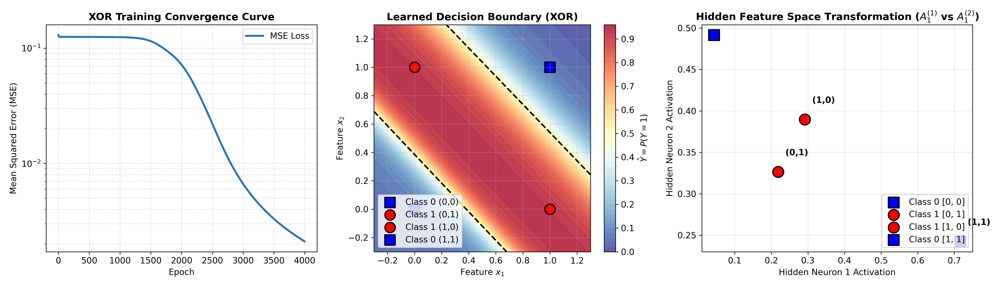
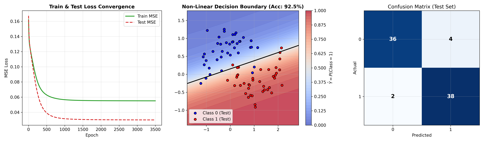
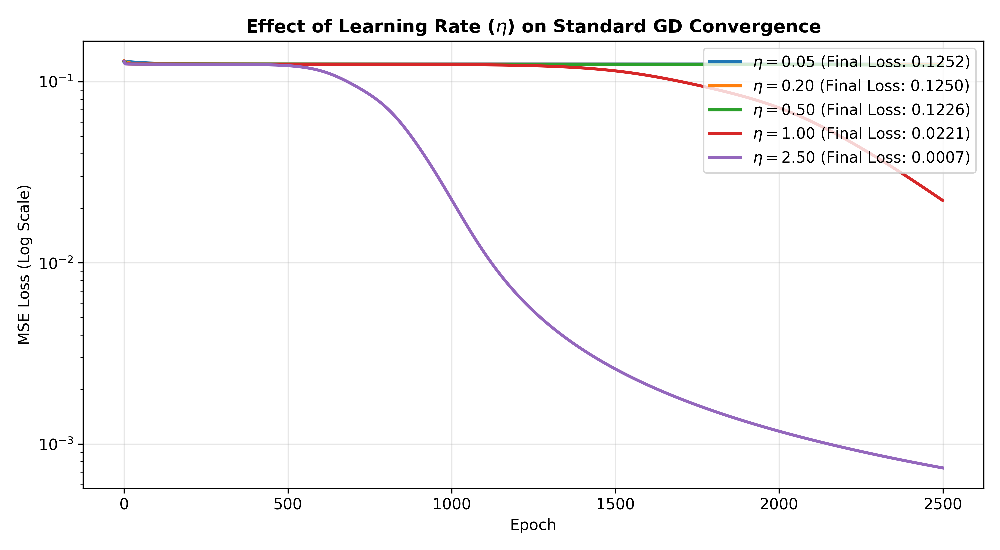
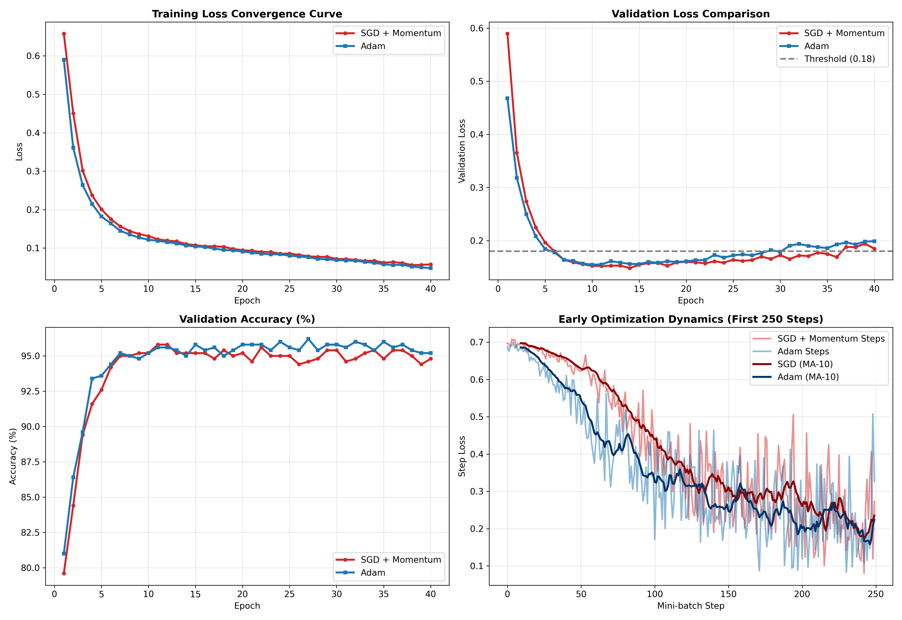
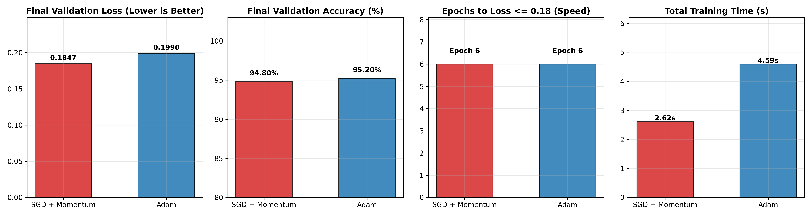
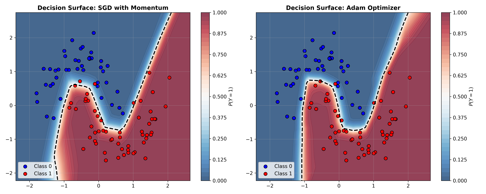

# Deep Learning Assignments & Practicals

[](https://www.python.org/)
[](https://numpy.org/)
[](https://pytorch.org/)
[](https://jupyter.org/)
[](LICENSE)

This repository contains rigorous implementations, mathematical derivations, and comparative empirical evaluations for foundational deep learning algorithms:
1. **Backpropagation Algorithm from Scratch (NumPy):** Multi-Layer Perceptron (1 hidden layer) with Mean Squared Error (MSE) loss and standard Gradient Descent.
2. **Optimizer Benchmarking (PyTorch):** Controlled training of a Feedforward Neural Network on a synthetic dataset comparing **Stochastic Gradient Descent (SGD) with Momentum** versus the **Adam Optimizer**.

---

## Table of Contents
- [Repository Structure](#repository-structure)
- [Program 1: Backpropagation from Scratch (NumPy)](#program-1-backpropagation-from-scratch-numpy)
  - [Mathematical Derivations](#mathematical-derivations)
  - [Numerical Gradient Checking](#numerical-gradient-checking)
  - [XOR Benchmark & Hidden Space Representation](#xor-benchmark--hidden-space-representation)
  - [Synthetic Moons Classification & Learning Rate Dynamics](#synthetic-moons-classification--learning-rate-dynamics)
- [Program 2: Optimizer Comparison in PyTorch](#program-2-optimizer-comparison-in-pytorch)
  - [Controlled Experimental Setup](#controlled-experimental-setup)
  - [Quantitative Results Summary](#quantitative-results-summary)
  - [Visualizations & Key Insights](#visualizations--key-insights)
- [Getting Started & Reproduction](#getting-started--reproduction)

---

## Repository Structure

```
deep-learning-assignments/
├── 01_Backpropagation_MLP_Scratch.ipynb   # Executed Jupyter Notebook for Program 1
├── 01_Backpropagation_MLP_Scratch.py       # Standalone executable script for Program 1
├── 02_Optimizer_Comparison_PyTorch.ipynb   # Executed Jupyter Notebook for Program 2
├── 02_Optimizer_Comparison_PyTorch.py       # Standalone executable script for Program 2
├── mlp_scratch_xor_visualizations.png       # XOR convergence, decision boundary & hidden representation
├── mlp_scratch_synthetic_visualizations.png # Synthetic dataset loss curve, decision boundary & confusion matrix
├── mlp_learning_rate_sensitivity.png       # Learning rate convergence comparison
├── optimizer_comparison_curves.png         # Train/Val loss, accuracy & early step dynamics
├── optimizer_comparison_metrics_bar.png    # Performance metric summary bar charts
├── optimizer_decision_surfaces.png         # 2D decision boundary comparison (SGD+Momentum vs Adam)
└── README.md                               # Project documentation and analysis
```

---

## Program 1: Backpropagation from Scratch (NumPy)

- **Notebook:** [`01_Backpropagation_MLP_Scratch.ipynb`](01_Backpropagation_MLP_Scratch.ipynb)
- **Script:** [`01_Backpropagation_MLP_Scratch.py`](01_Backpropagation_MLP_Scratch.py)

### Mathematical Derivations

For an input batch $X \in \mathbb{R}^{N \times d_{\text{in}}}$ and target labels $Y \in \mathbb{R}^{N \times d_{\text{out}}}$:

$$\begin{aligned}
\text{Hidden Layer:} \quad & Z_1 = X W_1 + b_1, \quad & A_1 = \sigma(Z_1) = \frac{1}{1 + e^{-Z_1}} \\
\text{Output Layer:} \quad & Z_2 = A_1 W_2 + b_2, \quad & \hat{Y} = A_2 = \sigma(Z_2) = \frac{1}{1 + e^{-Z_2}}
\end{aligned}$$

#### Mean Squared Error (MSE) Loss:
$$\mathcal{L} = \frac{1}{2N} \sum_{i=1}^N \| A_{2, i} - Y_i \|^2 = \frac{1}{2N} \| A_2 - Y \|_F^2$$

#### Analytical Gradients via the Chain Rule:
$$\begin{aligned}
\delta_2 &= \frac{\partial \mathcal{L}}{\partial Z_2} = \frac{1}{N} (A_2 - Y) \odot A_2 \odot (1 - A_2) \\
\frac{\partial \mathcal{L}}{\partial W_2} &= A_1^T \delta_2, \qquad \frac{\partial \mathcal{L}}{\partial b_2} = \sum_{i=1}^N \delta_{2, i} \\
\delta_1 &= \frac{\partial \mathcal{L}}{\partial Z_1} = (\delta_2 W_2^T) \odot A_1 \odot (1 - A_1) \\
\frac{\partial \mathcal{L}}{\partial W_1} &= X^T \delta_1, \qquad \frac{\partial \mathcal{L}}{\partial b_1} = \sum_{i=1}^N \delta_{1, i}
\end{aligned}$$

#### Parameter Updates:
$$W_l \leftarrow W_l - \eta \frac{\partial \mathcal{L}}{\partial W_l}, \qquad b_l \leftarrow b_l - \eta \frac{\partial \mathcal{L}}{\partial b_l}$$

### Numerical Gradient Checking
Analytical backpropagation gradients were verified against two-sided finite difference approximations ($\epsilon = 10^{-5}$):

| Parameter | Tensor Shape | Relative Difference | Verification Status |
| :--- | :--- | :--- | :--- |
| $W_1$ | `(2, 4)` | $1.3719 \times 10^{-10}$ | **PASSED (< 1e-7)** |
| $b_1$ | `(1, 4)` | $5.9053 \times 10^{-11}$ | **PASSED (< 1e-7)** |
| $W_2$ | `(4, 1)` | $1.4901 \times 10^{-11}$ | **PASSED (< 1e-7)** |
| $b_2$ | `(1, 1)` | $1.2935 \times 10^{-11}$ | **PASSED (< 1e-7)** |

### XOR Benchmark & Hidden Space Representation
The network successfully solved the non-linearly separable XOR problem, converging from an initial loss of $0.1298$ down to $0.0021$ ($100\%$ accuracy).



> **Key Takeaway:** The third subplot reveals how the hidden layer non-linear Sigmoid activation maps the 2D input $(x_1, x_2)$ into a transformed activation space $(A_1^{(1)}, A_1^{(2)})$ where the XOR classes become linearly separable.

### Synthetic Moons Classification & Learning Rate Dynamics
The scratch MLP was evaluated on a noisy synthetic 2D Two-Moons dataset ($N=400$, $\sigma=0.20$), achieving **$92.50\%$** test accuracy with a smooth non-linear decision boundary:



Evaluating gradient descent across learning rates $\eta \in [0.05, 0.20, 0.50, 1.00, 2.50]$ demonstrates how higher step sizes accelerate early convergence while excessive learning rates introduce oscillations:



---

## Program 2: Optimizer Comparison in PyTorch

- **Notebook:** [`02_Optimizer_Comparison_PyTorch.ipynb`](02_Optimizer_Comparison_PyTorch.ipynb)
- **Script:** [`02_Optimizer_Comparison_PyTorch.py`](02_Optimizer_Comparison_PyTorch.py)

### Controlled Experimental Setup
- **Dataset:** 2,500 synthetic samples with 20 features (15 informative, 5 redundant) and non-linear cluster geometry. Standardized via `StandardScaler`.
- **Model Architecture:** Fully connected neural network:
  $$\text{Input (20)} \xrightarrow{\text{Linear}} 64 \xrightarrow{\text{ReLU}} 32 \xrightarrow{\text{ReLU}} 1 \xrightarrow{\text{Sigmoid}} \hat{y}$$
- **Identical Initialization:** `initial_state_dict = copy.deepcopy(model.state_dict())` guarantees both optimizers begin from the **exact same loss landscape coordinate**.
- **Configurations:**
  - **SGD with Momentum:** $\eta = 0.01$, $\gamma = 0.9$
  - **Adam Optimizer:** $\eta = 0.001$, $\beta_1 = 0.9$, $\beta_2 = 0.999$, $\epsilon = 10^{-8}$

### Quantitative Results Summary

| Optimizer | Hyperparameters | Initial Loss | Final Train Loss | Final Val Loss | Final Val Accuracy | Convergence Epoch ($\mathcal{L} \le 0.18$) | Total Time |
| :--- | :--- | :--- | :--- | :--- | :--- | :--- | :--- |
| **SGD + Momentum** | $\eta=0.01, \gamma=0.9$ | $0.6579$ | $0.0576$ | **$0.1847$** | $94.80\%$ | Epoch 6 | **2.62 s** |
| **Adam** | $\eta=0.001, \beta=(0.9, 0.999)$ | $0.5900$ | **$0.0479$** | $0.1990$ | **$95.20\%$** | Epoch 6 | 4.59 s |

### Visualizations & Key Insights

#### 1. Convergence & Optimization Dynamics


- **Early-Stage Acceleration:** Adam reduces loss more rapidly during the first 5 epochs because its adaptive second-moment estimate ($\hat{v}_t$) scales up updates for parameters receiving smaller gradients.
- **Momentum Build-up:** SGD with Momentum gradually accumulates velocity vector $v_t = \gamma v_{t-1} + g_t$, dampening high-frequency oscillations across ravines and steepening its trajectory.

#### 2. Performance Comparison Bar Charts


- Adam achieved lower training loss ($0.0479$ vs $0.0576$).
- SGD with Momentum achieved a slightly lower validation loss ($0.1847$ vs $0.1990$), corroborating empirical findings that momentum methods often settle into flatter minima with superior generalization.
- SGD with Momentum incurs less memory and computation per step, tracking only one state buffer ($v_t$).

#### 3. 2D Decision Surfaces


---

## Getting Started & Reproduction

### Prerequisites
- Python 3.10+
- PyTorch, NumPy, Scikit-Learn, Matplotlib, Pandas

```bash
git clone https://github.com/Suyash728/deep-learning-assignments.git
cd deep-learning-assignments

# Optional: Create and activate virtual environment
python -m venv .venv
source .venv/bin/activate

# Install required dependencies
pip install torch numpy matplotlib scikit-learn pandas
```

### Running the Notebooks
Launch Jupyter to explore the interactive notebooks with pre-rendered outputs:
```bash
jupyter notebook 01_Backpropagation_MLP_Scratch.ipynb
jupyter notebook 02_Optimizer_Comparison_PyTorch.ipynb
```

### Running the Python Scripts
Execute the scripts directly to run training and save plots:
```bash
python 01_Backpropagation_MLP_Scratch.py
python 02_Optimizer_Comparison_PyTorch.py
```

---

## Author
- **Suyash** ([@Suyash728](https://github.com/Suyash728))
